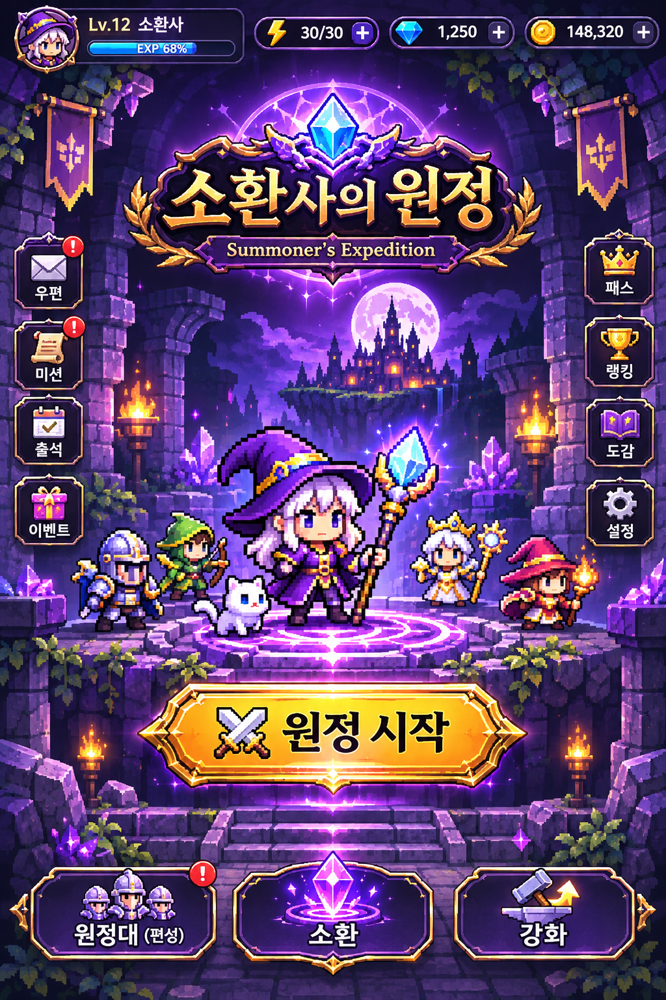
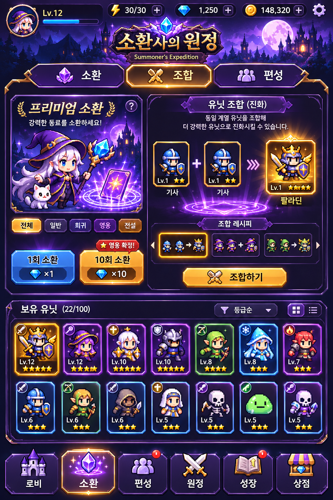
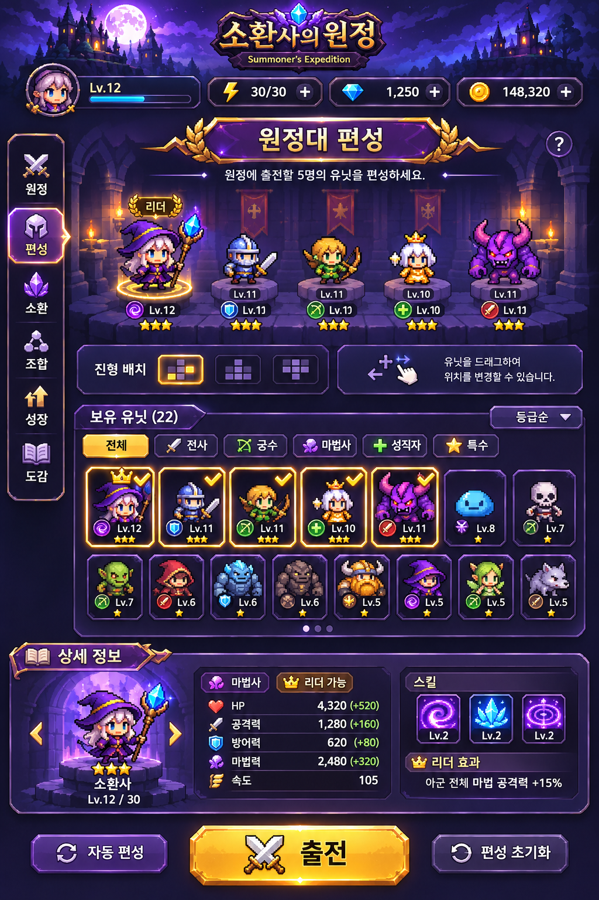
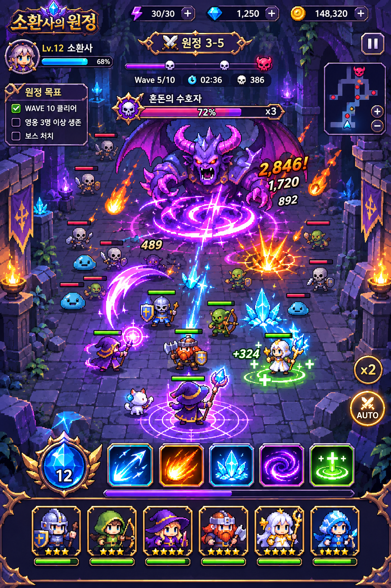
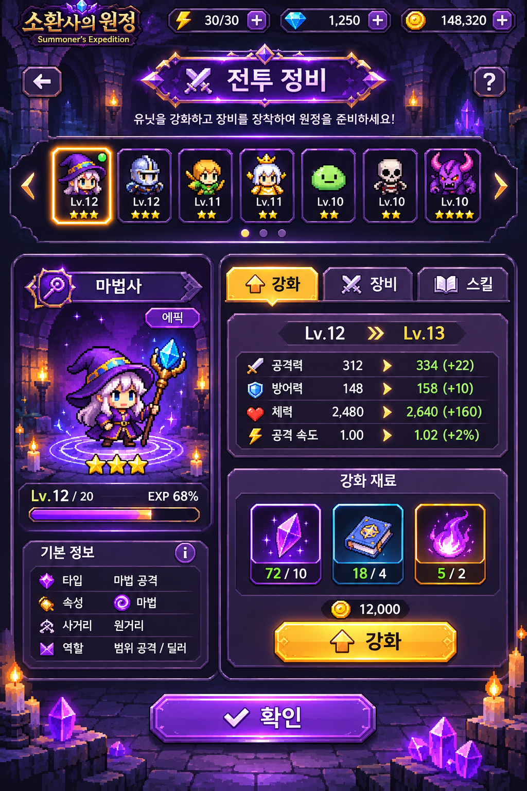
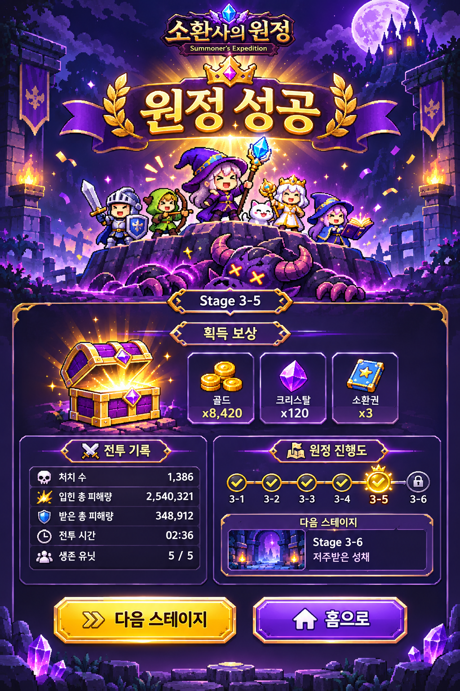

# 소환사의 원정 — 화면별 디자인 목업 및 개발 적용 가이드

> 프로젝트: [`jjhnom/toyPjt/rnd`](https://github.com/jjhnom/toyPjt/tree/main/rnd)  
> 디자인 레퍼런스: 사용자 제공 게임 플레이 영상 + 이 프로젝트의 기존 판타지 에셋 목록 및 코드 구조  
> 산출물: **세로형 독립 목업 PNG 6장** · 2026-11-09  
> 상태: **디자인 제안(구현/테스트/커밋하지 않음)**

## 1. 목적 및 범위

기존 **Phaser 3 + TypeScript + Vite + Capacitor(Android)** 게임을 보라색·금색 중심의 픽셀 판타지로 일관되게 리디자인한다. **방 탐험 → 전투 → 재화 획득 → 지정 소환 → 레시피 조합 → 분대 편성 → 다음 방**의 기존 게임 루프, 5개 스테이지, 보유/출전 제한과 저장 규칙은 그대로 둔다.

이 PNG는 **GitHub 원본 PNG를 직접 재배치한 화면이 아니라**, 저장소에서 확인한 이미지 종류·캐릭터 구성·코드를 참고하여 새로 생성한 *시각적 레퍼런스*이다. 등장 캐릭터의 실제 소스 스프라이트와 이미지 픽셀이 1:1로 대응하지 않으며, 예시 수치·아이콘·단추·콘텐츠가 실제 구현돼 있다는 뜻도 아니다.

## 2. 목업 미리보기

### 01. 메인 로비


**의도:** 보라빛 성과 소환사를 중심으로 시선을 모으고, **새 모험 / 이어하기**를 가장 분명한 액션으로 보이게 한다.  
**코드:** `src/scenes/MenuScene.ts`, `src/ui/fantasyTheme.ts`, `src/scenes/BootScene.ts`  
**주의:** 패스·상점·랭킹·우편·출석·에너지 등 목업 내 메뉴/재화는 신규 기능을 암시하므로, 해당 기능이 없는 경우 표시하지 않는다. 현재 메뉴의 새 모험/이어하기 동작과 체크포인트 정책을 보존한다.

### 02. 소환 및 조합


**의도:** 지정 소환 비용과 단위별 조합 재료를 카드 형태로 명료하게 보여주고, 희귀도별 프레임을 통일한다.  
**코드:** `src/scenes/SquadScene.ts`, `src/config/squadData.ts`, `src/ui/recipePresentation.ts`, `src/ui/unitArt.ts`  
**주의:** 목업의 1회/10회 확률형 뽑기나 '동종 2개면 진화'는 **현재 레시피를 대체하는 요구사항이 아니다**. 실제 `SUMMON_OFFERS`, `COMBINATION_RECIPES`를 기반으로 문구·비용·합성 결과·잠금 상태를 표시한다.

### 03. 원정대 편성


**의도:** 출전 중인 유닛과 보유 유닛을 구분하고, 유닛별 상태·티어·스킬·선택 상태를 명확히 표현한다.  
**코드:** `src/scenes/SquadScene.ts`, `src/systems/SquadRoster.ts`, `src/config/unitData.ts`, `src/ui/combatStatus.ts`  
**주의:** 드래그로 위치를 바꾸는 진형 배치, 자동 편성, 리더 보너스, 유닛 레벨/별 등급은 목업 표현이며 **독립적인 신규 기능 제안**이다. 기존 `deployed` 설정 및 출전 가능 인원 제한을 우선한다.

### 04. 실시간 전투


**의도:** 몬스터·아군 구분, 스킬의 타격 위치, 보스 공격 예고, HP/웨이브/미니맵 정보를 높은 대비로 표현한다.  
**코드:** `src/scenes/GameScene.ts`, `src/ui/skillEffectTextures.ts`, `src/ui/VirtualJoystick.ts`, `src/ui/pixelCharacters.ts`  
**주의:** 스킬 수동 버튼, AUTO, x2, 별도의 보스 게이지/목표 체크박스가 모두 현재 기능인 것은 아니다. **현재 방 이동·문·웨이브·자동 발동·가상 조이스틱 구조를 유지**하고 시각적 계층만 개선한다. HUD 및 이펙트가 조이스틱의 터치 영역과 충돌하지 않아야 한다.

### 05. 성장 화면 — 향후 기능 콘셉트


**의도:** 선택 유닛의 성장 전후 변화, 재료 소비, 세부 능력치와 스킬을 한눈에 보여주는 확장 가능성 검토용.  
**코드:** 현재 구현으로 가정하지 않는다. 기획 승인 이후 별도 화면과 데이터 모델을 검토한다.  
**주의:** 유닛 레벨업, 장비 장착, 강화 재료 및 신규 재화는 **이번 UI 리디자인 구현 범위에서 제외**한다.

### 06. 원정 결과


**의도:** 승리 감정을 크게 전달하고, 보상·전투 기록·다음 진행을 명확히 배치한다.  
**코드:** `src/scenes/GameOverScene.ts`, 현행 전투 및 정비 화면 전환부  
**주의:** 목업의 세부 재화와 맵 진행 표현은 예시다. 실제 승리/패배 결과와 체크포인트 삭제 조건을 유지하며, `RewardScene`을 전투 후 정비의 주 흐름으로 되돌리지 않는다. 정비는 기존 `SquadScene`을 사용한다.

## 3. 공통 디자인 시스템

| 요소 | 디자인 토큰(제안) | 목적 |
|---|---|---|
| 메인 배경 | `#12152F` | 밤하늘·던전의 깊이 |
| 어두운 패널 | `#2A1F3F` | 정보 그룹화 |
| 강조 보라 | `#6A30F0` | 마법·선택 탭·보조 액션 |
| 강조 금색 | `#FFD966` | 주요 CTA·희귀 보상 |
| 아이스 블루 | `#3FB7FF` | 마력석·냉기·아군 힌트 |
| 오렌지 | `#FF9F3A` | 화염·피해 강조 |
| 힐 그린 | `#68D96C` | 회복·성공/사용 가능 |
| 본문 | `#F4E9FF` | 높은 가독성 |

- **픽셀아트 일관성:** Phaser의 `pixelArt: true`, `roundPixels: true`, `Scale.FIT` 유지. 캐릭터와 아이콘은 원본 비율 유지 및 최근접 확대.
- **레이아웃:** 실좌표는 `src/config/gameData.ts`의 `GAME_WIDTH`, `GAME_HEIGHT`, `ARENA_BOUNDS`를 기준으로 한다. 생성 이미지 자체는 좌표가 정확한 와이어프레임이 아니다.
- **컨트롤:** 기본 터치 대상은 최소 48×48 *논리 픽셀*을 목표로 하고 실제 기기에서 검증한다. 상단 시스템 바·하단 제스처 바 안전 여백 확보.
- **정보 우선순위:** 상단은 생존/자원/진행도, 중앙은 캐릭터와 전투 또는 작업 목록, 하단은 주 행동/이동으로 일관성 유지.
- **상태 디자인:** 기본/선택/누름/비활성/잠금/비용 부족/재료 충분/알림을 동일한 컴포넌트 규칙으로 표현.
- **이펙트:** 보라 참격, 오렌지 화염, 파랑 빙결, 초록 치유. 지나친 화면 흔들림·발광은 조절하고 보스 경고 표시를 가리지 않는다.
- **접근성:** 작은 본문 텍스트를 줄이고, 희귀도는 색상뿐 아니라 이름/아이콘/별도 표기로 구별한다.

## 4. 실제 저장소 리소스 참조

현재 코드의 기존 디자인 함수를 우선 재사용한다.

```text
rnd/
├── src/assets/fantasy-v2/
│   ├── title.png
│   ├── dungeon.png
│   ├── frame.png
│   ├── archer.png
│   └── mage.png
├── src/assets/units-v3/
│   ├── units-atlas.png
│   └── sources/              # 개별 유닛 이미지
├── src/scenes/
│   ├── MenuScene.ts
│   ├── SquadScene.ts
│   ├── GameScene.ts
│   └── GameOverScene.ts
├── src/ui/
│   ├── fantasyTheme.ts       # FANTASY / paintPanel / pixelPanel / fantasyButton
│   ├── unitArt.ts
│   ├── pixelCharacters.ts
│   ├── skillEffectTextures.ts
│   └── VirtualJoystick.ts
└── src/config/
    ├── gameData.ts
    ├── squadData.ts
    └── unitData.ts
```

에셋은 기존 `BootScene.ts`의 로딩 등록, 유닛 이미지는 `unitArt.ts` / `pixelCharacters.ts`의 키 매핑을 확인한 후 사용한다. 기존 타이틀/던전 이미지를 우선 활용하고, 새로운 목업 캐릭터 일러스트를 그대로 게임에 덮어씌우지 않는다.

## 5. 구현 로드맵 및 완료 조건

| 우선순위 | 작업 | 완료 기준 |
|---|---|---|
| P0-1 | 공통 패널·버튼·팔레트 정리 | 기존 클릭 처리 및 텍스트 가독성 유지, 컴포넌트 상태별 규칙 일관 |
| P0-2 | 소환/조합/편성 UI | 실제 소환 비용·조합 레시피·출전 제한을 올바르게 표시; 재료 선택/판매/승급 보존 |
| P0-3 | 전투 HUD 및 VFX | 방/문/미니맵/스쿼드 상태와 조이스틱 유지; 모바일 FPS 및 전투 정보 확인 |
| P1-1 | 타이틀 | 새 모험/이어하기·확인 대화상자·저장 복원 동작 그대로 유지 |
| P1-2 | 결과 | 현재 승패 전환·보상·저장 삭제 정책 유지 |
| P2 | 성장/자동편성/수동스킬 등 신규 기능 | 별도 기획·데이터 계약·테스트 설계 및 사용자 승인 **후** 검토 |

### QA 체크리스트

- [ ] `npm test` 성공
- [ ] `npm run build` 성공
- [ ] 모바일 세로 비율에서 글자 잘림 및 중첩 없음
- [ ] 버튼 터치 영역이 텍스트·장식·모달에 가리지 않음
- [ ] 마력석 부족/재료 부족/보유 한도/출전 한도 등 비활성 상태가 분명함
- [ ] 전투 중 캐릭터 및 경고 패턴이 이펙트에 묻히지 않음
- [ ] 가상 조이스틱 및 멀티터치 회귀 없음
- [ ] 새 모험·이어하기·스테이지 시작 저장·승패 삭제 규칙 회귀 없음
- [ ] Android 실제 실행은 환경이 있을 때만 확인하고 검증 여부를 분리해 보고

## 6. Codex에 전달할 작업 지시문

> `rnd/AGENTS.md`, `rnd/.agent/rules.md`, `rnd/.agents/skills/smash-roguelike/SKILL.md`를 먼저 읽고 현재 코드와 목업의 차이를 분석해 주세요. `rnd/design/mockups/README.md`와 PNG 6장을 디자인 참조로 사용하되, 구현되지 않은 기능을 새로 만들지 마세요. 우선 `fantasyTheme.ts`의 공통 색상·패널·버튼을 다듬고, `SquadScene.ts`의 소환/조합/편성 UI를 실제 `squadData.ts` 규칙에 맞춰 개선하세요. 그다음 `GameScene.ts` HUD와 스킬 이펙트를 조정하세요. 게임 메커니즘·저장 정책·재화 규칙은 그대로 유지하고, 단계마다 수정 파일·변경 요약·`npm test`/`npm run build` 결과·미확인 사항을 한국어로 보고하세요. 신규 의존성/기능, push/merge는 별도 승인받으세요.

## 7. 저장소 배치

추천 위치는 `rnd/design/mockups/`이다. 다음과 같이 복사하면 이미지 미리보기 링크가 그대로 동작한다.

```text
rnd/design/mockups/
├── README.md
├── 01_lobby.png
├── 02_summon_combine.png
├── 03_squad_formation.png
├── 04_battle.png
├── 05_growth_concept.png
└── 06_victory_results.png
```

이 문서 및 이미지 작성만으로 GitHub 저장소가 변경되지는 않는다.
