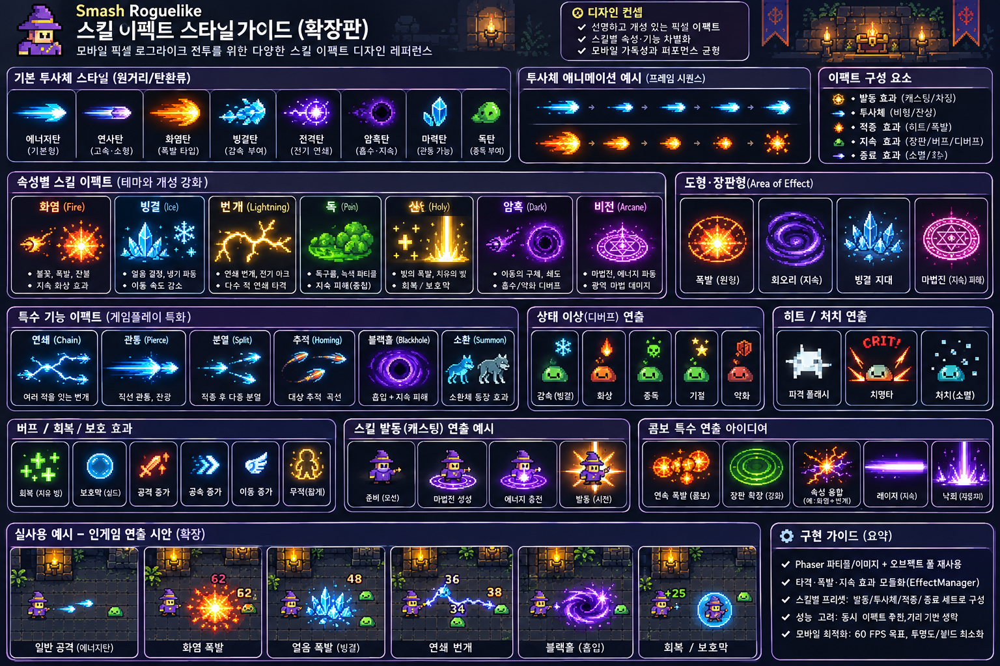

# Smash Roguelike — 스킬 이펙트 스타일 가이드 (확장판)

> 대상 프로젝트: `jjhnom/toyPjt`의 `rnd/` (Phaser 3 / TypeScript / Capacitor Android)  
> 문서 성격: **시각 디자인 제안 + Codex 구현 작업 명세**  
> 상태: **제안 단계 — 실제 소스 분석 및 승인 전 구현하지 않음**  
> 기준: 모바일 세로 화면, 선명한 픽셀 아트, 다수 적이 등장하는 로그라이크 전투

## 1. 비주얼 레퍼런스



이 이미지는 **컨셉 레퍼런스**입니다. 이미지 속 화염·빙결·번개·독·신성·암흑·비전, 블랙홀, 소환, 버프, 디버프, 콤보 연출은 *디자인 후보*이며, 현재 게임에 해당 스킬이 구현되어 있다는 뜻은 아닙니다. 실제 구현 여부와 명칭, 효과 수치는 소스코드를 기준으로 확인합니다. 이미지에 보이는 숫자와 작은 문구는 게임 밸런스 명세로 사용하지 않습니다.

### 디자인 목표
1. **가독성:** 작은 모바일 화면에서도 공격 종류와 적중 여부가 즉시 구별된다.
2. **일관성:** 동일 속성은 발동·투사체·충돌·잔류 효과에 공통 색/형태를 사용한다.
3. **타격감:** 적중 시 짧고 명확한 플래시, 파편, 피해 숫자로 피드백한다.
4. **절제:** 연출이 캐릭터·적·위험 영역을 가리지 않는다.
5. **성능:** 이펙트 수를 제한하고 풀링 및 재사용을 우선한다.

---

## 2. 이펙트 구성 원칙

모든 스킬을 아래 단계로 분해해 디자인합니다. **실제 공격 판정 타이밍과 시각 애니메이션 타이밍은 분리**하고 기존 게임 로직을 바꾸지 않습니다.

| 단계 | 표현 | 기본 원칙 |
|---|---|---|
| 발동 / 캐스팅 | 마법진, 작은 광채, 에너지 충전 | 발동 상태를 명확하게 전달 |
| 비행 / 이동 | 투사체 실루엣, 짧은 잔상 | 화면에서 방향과 속도를 식별 |
| 적중 / 폭발 | 히트 플래시, 충격 링, 파편 | 타격감의 중심; 짧고 선명하게 |
| 지속 / 상태 | 장판, 오라, 디버프 아이콘 | 실제 지속 효과가 있을 때만 사용 |
| 종료 / 소멸 | 입자 소멸, 페이드, 잔광 | 풀 재사용 전에 상태 완전 초기화 |

### 시각 강도 3단계

| 단계 | 용도 | 제안 표현 |
|---|---|---|
| S — 일반 공격 | 잦은 기본 공격 | 작은 탄환 + 1회 히트 플래시 |
| M — 스킬 | 쿨타임 기반 공격 | 속성별 투사체 + 충격 링/파편 |
| L — 특수/필살 | 드문 강력한 공격 | 예고 연출 + 큰 타격 + 짧은 강조 |

> S/M/L은 **연출 예산** 구분이며 피해량이나 실제 스킬 등급이 아닙니다.

---

## 3. 기본 투사체 스타일

| 유형 | 외형 | 비행 연출 | 적중 연출 | 사용 조건 |
|---|---|---|---|---|
| 에너지탄 | 하늘색 뾰족한 광탄 | 짧은 청록 잔상 | 작은 별형 섬광 | 일반 마법 공격 |
| 연사탄 | 얇고 빠른 보라/청색 탄 | 짧은 스트릭 | 작은 스파크 | 연속 발사 공격 |
| 화염탄 | 주황·노랑 불꽃 꼬리 | 픽셀 불씨 | 불꽃 파열 | 화염 속성이 존재할 때 |
| 빙결탄 | 파랑 결정체 | 작은 얼음 조각 | 얼음 파편 | 빙결 속성이 존재할 때 |
| 전격탄 | 보라/백색 에너지 구체 | 전기 스파크 | 방전 섬광 | 번개 속성이 존재할 때 |
| 암흑탄 | 자주색 어두운 코어 | 미세한 보라 입자 | 그림자 파동 | 암흑 속성이 존재할 때 |
| 마력탄 | 푸른 결정 조각 | 은은한 반짝임 | 결정 파편 | 마력 계열이 존재할 때 |
| 독탄 | 연두색 점액탄 | 작은 점액 입자 | 녹색 비산 | 독 속성이 존재할 때 |

**규칙:** 색상만 바꾸지 말고 **실루엣과 궤적**도 달리해 색각 차이에 의존하지 않도록 합니다.

---

## 4. 속성별 이펙트 스타일

| 속성 | 추천 색상 (초안) | 핵심 형태 | 적중/지속 표현 | 주의 |
|---|---|---|---|---|
| 화염 Fire | `#FF8A2A`, `#FFD05A` | 불꽃, 원형 폭발 | 불씨, 폭발 링 | 지속 화상은 실제 디버프가 있을 때만 |
| 빙결 Ice | `#67D8FF`, `#B8F4FF` | 육각 결정, 서리 | 얼음 파편, 냉기 파동 | 감속 효과를 시각 연출만으로 추가하지 않음 |
| 번개 Lightning | `#FFD65C`, `#B78CFF` | 갈라진 전기 아크 | 연쇄 스파크, 순간 섬광 | 광과민성 위험을 고려해 빠른 전면 점멸 지양 |
| 독 Poison | `#79D842`, `#B2F06A` | 점액, 기포, 연무 | 독성 방울, 작은 구름 | 지속 피해는 기존 로직 기준 |
| 신성 Holy | `#FFE6A0`, `#FFF5D6` | 빛 기둥, 십자형 반짝임 | 부드러운 광채, 보호 오라 | 회복/보호 기능 임의 추가 금지 |
| 암흑 Dark | `#8C54D8`, `#D59AFF` | 어두운 코어, 소용돌이 | 그림자 파동, 보라 입자 | 검은색만 사용해 식별성이 떨어지지 않도록 |
| 비전 Arcane | `#EF6FD9`, `#FFB6F2` | 기하학 마법진, 룬 | 마력 파동, 회전 문양 | 작은 화면에서 복잡한 룬은 단순화 |

색상 값은 **제안값**이며 실제 프로젝트의 `fantasyTheme.ts`와 대조 후 확정합니다.

---

## 5. 범위 공격 / 장판 (AoE)

| 연출 | 컨셉 | 화면 표시 | 구현 시 유의점 |
|---|---|---|---|
| 폭발 링 | 중심에서 확장되는 불꽃 원 | 예고 원 → 충격 → 잔불 | 실제 공격 반경과 시각 반경 일치 |
| 회오리 | 보라/청록 회전 소용돌이 | 회전 입자 + 중심 코어 | 시야 차단 최소화 |
| 빙결 지대 | 얼음 결정이 솟는 원형 영역 | 테두리 → 결정 → 소멸 | 실제 장판이 있을 때만 유지 |
| 마법진 | 비전 문양의 원형 필드 | 짧은 룬 점등과 회전 | 지속 시간과 판정 동기화 |

**필수:** 위험 범위가 존재한다면 배경 장식보다 **판정 경계선**이 우선 보이게 합니다.

---

## 6. 특수 기능 연출

### 6.1 연쇄 번개 (Chain)
- 첫 타격 대상에서 다음 대상으로 짧은 번개 선을 연결.
- 분기마다 두께·밝기를 약간 줄임.
- **실제 연쇄 타격 기능이 있을 때만** 연출.

### 6.2 관통탄 (Pierce)
- 한 방향으로 긴 에너지 꼬리와 관통 스트릭 표현.
- 적중 시 작은 충격 효과만 남겨 연속 타격을 방해하지 않음.
- **관통 판정은 기존 충돌 로직을 그대로 사용.**

### 6.3 분열탄 (Split)
- 충돌/지정 조건 이후 작은 탄환 여러 개로 시각적으로 분기.
- 분열 수와 방향은 기존 실제 발사 로직에 일치시킴.

### 6.4 추적탄 (Homing)
- 목표를 향해 완만히 휘는 꼬리 궤적.
- 실제 추적 기능이 없는 탄환에는 적용하지 않음.

### 6.5 블랙홀 (Blackhole)
- 중심의 어두운 원과 보라색 회전 테두리.
- 흡입·지속 피해 등 게임 효과는 기존 구현 여부 확인 후 표현.
- 입자가 많아지지 않도록 링 텍스처/스프라이트 애니메이션 활용.

### 6.6 소환 (Summon)
- 바닥 마법진 → 점등 → 유닛 등장 → 문양 소멸.
- 실제 소환 타이밍·편성 상한·유닛 상태를 변경하지 않음.
- 유닛 출현 중 입력 및 상태 중복 처리에 주의.

---

## 7. 상태 이상 / 디버프 표현

| 상태 | 제안 이펙트 | 권장 표현 방식 |
|---|---|---|
| 감속/빙결 | 눈송이와 푸른 서리 | 캐릭터 외곽 소형 아이콘 + 서리 |
| 화상 | 작은 불꽃 | 머리 위/발밑에 소형 불꽃 |
| 중독 | 녹색 기포와 해골 아이콘 | 작은 독 입자 + 상태 아이콘 |
| 기절 | 별 또는 회전하는 작은 문양 | 머리 위 명확한 상태 표시 |
| 약화 | 붉은 방패 파손 문양 | 짧은 디버프 아이콘 |

**상태 이상이 실제 게임에 없으면 해당 연출은 보류**합니다. 효과가 없는 상태 아이콘을 보여주면 플레이어에게 잘못된 정보를 줍니다.

---

## 8. 버프 / 회복 / 보호 연출

| 종류 | 표현 | 사용 원칙 |
|---|---|---|
| 회복 | 초록색 플러스, 위로 올라가는 작은 빛 | 실제 HP 회복 시 |
| 보호막 | 반투명 푸른 링/돔 | 실제 보호막 상태 시 |
| 공격 증가 | 붉은/주황색 상승 화살표 | 실제 공격 버프 시 |
| 공격 속도 증가 | 청록색 이중 화살표 | 실제 속도 버프 시 |
| 이동 속도 증가 | 파란 바람 자취 | 실제 이동 버프 시 |
| 무적 | 금빛 캐릭터 테두리 | 실제 무적 상태 시 |

투명도와 레이어를 조절하여 캐릭터 본체가 가려지지 않도록 합니다.

---

## 9. 타격 / 치명타 / 처치

- **일반 적중:** 1회 짧은 백색 히트 플래시 + 작은 스파크.
- **치명타:** 더 큰 타격 별 + 구분 가능한 데미지 숫자 스타일.
- **처치:** 작은 픽셀 파편 또는 페이드 소멸.
- **피해 숫자:** 연속 타격 시 과도한 중첩을 피하도록 위치/동시 개수 제한.
- **카메라 흔들림:** 매우 강한 공격에만 선택 적용, 일반 공격에는 사용하지 않음.
- **접근성:** 과도한 번쩍임·큰 흔들림을 피하고 이펙트 감소 옵션을 고려.

**게임 판정, 피해 수치, 치명타 확률, 처치 보상은 수정하지 않습니다.**

---

## 10. 캐스팅 애니메이션

1. **준비:** 발밑에 작은 마법진 또는 무기 발광.
2. **충전:** 에너지 점이 중심으로 모이거나 작은 빛이 강해짐.
3. **발동:** 실제 스킬 발사 시점에 짧은 섬광.
4. **종료:** 마법진과 잔광이 빠르게 사라짐.

캐스팅 연출은 **실제 공격 지연을 새로 만들지 않으며**, 기존 공격 주기와 애니메이션 이벤트를 기준으로 동기화합니다.

---

## 11. 콤보 / 특수 연출 후보

| 유형 | 시각 컨셉 | 주의 |
|---|---|---|
| 연속 폭발 | 작은 폭발 3회가 순차적으로 점등 | 실제 다중 타격 수와 동기화 |
| 장판 확장 | 초록/보라 링이 단계적으로 확장 | 실제 범위 변화가 없다면 시각 강조만 |
| 속성 융합 | 두 속성의 입자가 충돌해 한 번 폭발 | 게임 내 융합 시스템이 있을 때만 |
| 레이저 | 선명한 직선 광선 + 끝점 히트 | 판정 선과 시각 선 일치 |
| 낙뢰 | 위에서 내려오는 수직 빛 기둥 | 예고와 타격 타이밍 분리 |

---

## 12. Phaser 구현 가이드

### 12.1 기존 코드 우선 조사
- `AGENTS.md`, `.agent/rules.md`, `.agents/skills/` 지침 확인.
- 현재 공격/스킬/투사체/피격/상태 이상 로직 및 실제 사용 에셋 조사.
- 기존 이펙트 관리자, 파티클, 풀링 시스템이 있는지 먼저 확인.
- **이미 존재하는 기능은 재사용하고 중복 관리자 생성 금지.**

### 12.2 추천 설계 (필요할 때만)
시각 효과를 게임 판정에서 분리하는 `CombatEffectManager` 또는 동등한 기존 시스템을 활용합니다.

개념적 인터페이스 예시:

```ts
type EffectKind =
  | 'cast' | 'projectileTrail' | 'hit' | 'explosion'
  | 'status' | 'heal' | 'shield' | 'death';

interface EffectRequest {
  kind: EffectKind;
  x: number;
  y: number;
  styleId: string;
  intensity?: 'small' | 'medium' | 'large';
}
```

이는 **설계 예시**이며 기존 코드에 바로 복사할 확정 API가 아닙니다. 실제 타입·씬·객체 풀 구조를 조사한 뒤 결정합니다.

### 12.3 성능 및 수명주기
- Phaser의 기존 ParticleEmitter, Tween, Sprite Animation, Graphics 중 적합한 도구를 선택.
- 자주 생성되는 투사체·히트 효과는 오브젝트 풀 재사용.
- 이펙트 동시 생성량을 제한하고 화면 밖 연출은 생략 가능하도록 설계.
- 매 프레임 불필요한 객체 생성, 복잡한 Graphics 재그리기 최소화.
- 풀 반환 시 위치, 알파, 스케일, 색조, 애니메이션, 타이머, 리스너 초기화.
- 씬 종료·룸 전환·재시작 시 활성 효과 정리.
- 60 FPS는 **목표**이며 실기기 측정 전 성능 달성을 주장하지 않음.
- 저사양 모드: 잔상 감소, 파티클 수 감소, 흔들림 비활성화 검토.

### 12.4 레이어 권장 순서
1. 바닥·벽 장식
2. 바닥 장판/예고 범위
3. 캐릭터·몬스터
4. 투사체·적중 이펙트
5. 피해 숫자·상태 아이콘
6. HUD·터치 조작 UI

실제 Depth 값은 현재 프로젝트의 렌더링 구조를 확인하고 정합니다.

---

## 13. 단계별 작업 계획

| Phase | 작업 | 결과물 | 승인 조건 |
|---|---|---|---|
| 0 | 기존 공격·스킬·이펙트 조사 | 실제 스킬 목록, 수정 예상 파일, 위험 분석 | 구현 없이 계획 승인 |
| 1 | 기본 투사체·히트·피해 숫자 | 일반 공격의 시각 개선 | 기존 피해/충돌 동일 |
| 2 | 실제 구현된 속성 이펙트 | 속성별 스프라이트/파티클 | 시인성·판정 일치 |
| 3 | AoE·연쇄·관통 등 기존 특수기 | 스킬별 연출 차별화 | 범위·타이밍 유지 |
| 4 | 버프/디버프·캐스팅·처치 | 상태 가독성 향상 | 실제 상태와 일치 |
| 5 | 모바일 최적화·QA | 성능 비교 및 테스트 결과 | 회귀 테스트 통과 |

한 번에 전체 시스템을 변경하지 않고 **Phase 1부터 작은 PR 단위**로 진행합니다.

---

## 14. 검증 체크리스트

- [ ] 기존 공격력·공격 속도·사거리·치명타 확률 유지
- [ ] 실제 공격/스킬 목록에 없는 기능 임의 추가 없음
- [ ] 스킬 시각 반경과 실제 판정 범위 불일치 없음
- [ ] 적중/처치/보상 중복 처리 없음
- [ ] 룸 전환·게임오버·재시작 시 잔류 이펙트 없음
- [ ] 다수 적/투사체에서 HUD·캐릭터 식별 가능
- [ ] 모바일 터치 입력과 소환·조합 UI 정상
- [ ] `npm test` 실행 및 결과 기록
- [ ] `npm run build` 실행 및 결과 기록
- [ ] 가능 시 브라우저 스모크 테스트 실행
- [ ] 가능 시 Android 실기기 성능 측정
- [ ] 변경 전/후 스크린샷 또는 짧은 영상 비교
- [ ] 미실행 테스트를 성공으로 표기하지 않음

---

## 15. Codex에 전달할 실행 프롬프트

아래 내용을 VS Code Codex 채팅에 붙여 넣고 **이 MD 파일과 시안 PNG를 함께 첨부**하세요.

```text
$producer

Smash Roguelike의 스킬/전투 이펙트를 확장 리디자인하고 싶습니다.
첨부한 smash_roguelike_skill_effect_style_guide.md와
a_detailed_polished_game_design_moodboard_guide_im.png를 기준으로 진행하세요.

1. AGENTS.md, .agent/rules.md 및 관련 Skills를 먼저 읽어주세요.
2. 실제 소스에서 현재 구현된 공격/스킬/투사체/피격/상태 이상을 조사하세요.
3. 가이드의 이펙트는 디자인 후보입니다. 구현되지 않은 스킬,
   버프, 디버프, 블랙홀, 레이저 등을 임의로 추가하지 마세요.
4. 현재 스킬별로 '현행 이펙트 → 추천 스타일 → 수정 파일 →
   예상 성능 영향 → 완료 조건' 표를 작성하세요.
5. Phase 1(기본 투사체·히트·피해 숫자)만 상세 구현 계획을 세우세요.
6. 실제 게임 판정, 피해량, 공격 주기, 소환·조합, 룸 진행을 유지하세요.
7. 새 라이브러리 도입과 대규모 리팩터링은 사전 승인을 받으세요.
8. 아직 코드를 수정하지 말고 한국어로 분석 결과를 보고하세요.
```

### 구현 승인 후 다음 프롬프트

```text
$gameplay-engineer

승인된 Phase 1 범위만 구현하세요.
기존 이펙트·투사체 시스템을 재사용하고 최소 파일만 변경하세요.
구현 후 $game-test, $phaser-performance, $mobile-qa,
$code-review 관점에서 검증하고 실제 실행 결과를 보고하세요.
기존 전투 판정과 밸런스는 변경하지 마세요.
```

---

## 16. 작업 완료 보고 형식

```markdown
## 스킬 이펙트 Phase N 결과
- 작업 범위:
- 실제 개선한 스킬/공격:
- 변경 파일:
- 사용한 이펙트 방식:
- 변경 전/후 이미지 또는 영상:
- 테스트 명령과 결과:
- FPS/메모리 측정 조건 및 결과:
- Android 실기기 검증 여부:
- 미확인 항목:
- 다음 단계 제안:
```

**최종 기준:** 더 화려한 효과보다 **공격 판정의 정확성, 전투 가독성, 스킬별 개성, 모바일 성능**을 우선합니다.
