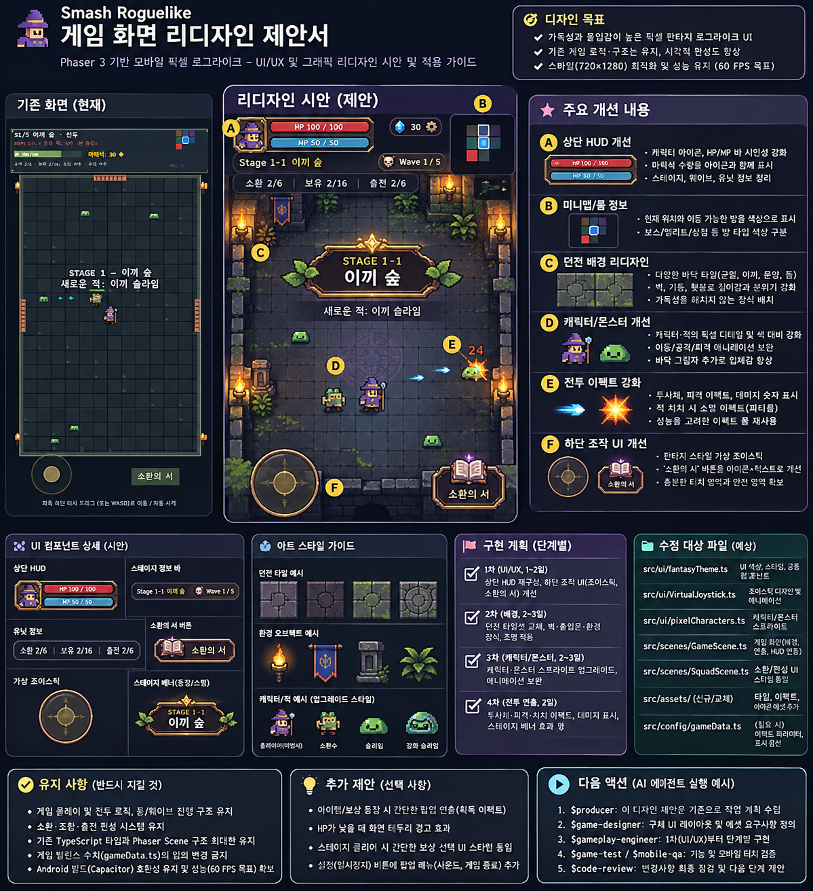

# 소환사의 원정 — 모바일 게임 UI 리디자인 제안서

> 프로젝트: `jjhnom/toyPjt/rnd`  
> 엔진: Phaser 3 + TypeScript + Vite + Capacitor Android  
> 기준 화면: 사용자가 제공한 현재 모바일 게임 스크린샷  
> 화면: 720 × 1280 세로형 / 픽셀 판타지 로그라이크  
> 상태: **2026-11-05 UI-003 소환 유닛 22종 개별 아트 및 브라우저/dist 검증 완료 — 적 신규 아트·새 공격 애니메이션·Android 실기기는 별도**

### 2026-11-05 소환 유닛 전체 교체 (UI-003)

- UI-002에서 남았던 유닛과 공유 이미지를 사용하던 궁수 계열을 포함해 21종을 새로 제작했다. 기존 숲의 사수와 합쳐 소환/조합 유닛 22종 모두 개별 이미지를 사용한다.
- 목록/분대 초상화는 별도 96px 텍스처를 사용하고, 전투는 기존 48px·4프레임을 유지한다. 프레임 매핑 누락은 타입/테스트로 검사하며 22종 전투/초상화 각각의 픽셀 해시도 모두 다름을 확인했다.
- 원본은 프로젝트에 보존하고 게임에는 512KB 아틀라스 한 장을 포함한다. [생성 모드/최종 프롬프트·준비 방법](../../../src/assets/units-v3/README.md), [실제 소환 화면·22종 전체 캡처/검증](../../../artifacts/unit-art-validation/report.md).
- `npm test` 21개·빌드·Chrome 모바일 전체 회귀·실제 dist 이미지 로딩 통과. UI-002 아래의 미완료 유닛 아트 기록은 당시 상태이며 이 작업에서 보완했다.

### 2026-11-05 시각적 격차 보완 (UI-002)

- 아래 UI-001 기록은 도형·색상·HUD 중심의 1차 개선이었다. 타이틀과 시안의 풍부한 재질/장식 표현이 충분히 반영되지 않았으며, 이전의 Phase 전체 완료 표시는 과도했다.
- 새 프로젝트 아트 5개를 생성·저장하고 실제 게임에 적용했다: 포털/유적 타이틀, 균열 석재·덩굴·횃불 던전, 금색/보라 보석 장식 프레임, 소환사와 궁수. 생성 방식·최종 프롬프트는 [아트 README](../../../src/assets/fantasy-v2/README.md)에 보존했다.
- BootScene에서 실제 PNG를 로드하고 버튼/읽기용 패널 텍스처를 구분한다. 타이틀·전투·정비·결과 화면을 함께 갱신했으며 게임 데이터와 터치 영역은 유지했다.
- `npm test` 20개, `npm run build`, Chrome 모바일 터치 스모크 통과. 실제 `dist`를 4173에서 실행해 PNG 5개 HTTP 200, 720×1280/360×640 타이틀/전투 화면과 예외 0건을 별도 확인했다.
- [UI-002 실제 전후 화면/검증 보고서](../../../artifacts/ui-redesign-v2/report.md). 전체 22종 유닛·적의 신규 개별 아트 및 방향별 공격 애니메이션, Android 실기기/장시간 부하는 완료로 간주하지 않는다.

### 2026-11-05 1차 적용 결과 (UI-001 기록)

- 사용자의 문서·이미지 기반 디자인 개선 요청에 따라 기존 게임에 적용했다. 아래의 사전 승인 절차 예시는 이후 별도 변경을 계획할 때 참고한다.
- HP/재화/진행/분대를 분리한 HUD, 6개 유닛 초상·HP·전투 불능 표시, 방 타입별 아이콘과 현재 위치가 있는 미니맵을 적용했다. FPS는 `?debug`에서만 표시한다.
- 기존 터치 영역에 책 아이콘·눌림 피드백을 적용하고, 조이스틱의 크기·이동 판정을 유지한 채 금속 링 외형을 교체했다. 버튼 터치가 조이스틱 앵커로 중복 전달되지 않도록 했다.
- 바닥 6종 변형, 벽돌 명암·문 프레임·횃불, 캐릭터 그림자와 외곽선·소환사 실루엣, 아군 청록/파랑과 적 위험 주황 계열, 짧은 상단 명패를 적용했다. 충돌·공격 수치와 룸/웨이브/조합 데이터는 유지했다.
- 기존 적 80·탄환 160·파티클 120·데미지 텍스트 60개 풀을 재사용한다. 새로운 전투 객체 풀이나 MP/스킬 메커니즘은 추가하지 않았다.
- `npm test` 20개, `npm run build`, Chrome 156의 720×1280/360×640 터치 검증 통과. HUD 범위, 이동 중 책 버튼 멀티터치, 터치 취소, 정비/복귀 및 저장·이어하기를 확인했다.
- 같은 Windows Headless Chrome에서 적 28기·탄환 최대 150개·10초 조건의 FPS는 적용 전 평균 60.5/최저 60.1, 적용 후 평균 60.3/최저 59.9였다. 짧은 브라우저 관찰 결과이며 실기기 성능 보장은 아니다.
- 전후 화면과 한계는 [UI 검증 보고서](../../../artifacts/ui-redesign-validation/report.md)에 기록했다. 실제 Android 노치·시스템 제스처·앱 전환 QA는 별도다.

## 1. 리디자인 시안



**주의:** 위 이미지는 *컨셉 시안*입니다. MP 게이지, 일부 몬스터 표현, 장식 및 아이콘은 실제 구현에 없는 예시일 수 있습니다. **현재 게임에 없는 기능을 새로 구현하라는 의미가 아닙니다.** 이미지 속 작은 글씨보다 아래 명세를 우선하세요.

## 2. 디자인 목표

- 기존의 픽셀 판타지 정체성을 유지하면서 **상용 모바일 RPG 수준의 가독성·시각적 완성도**를 목표로 한다.
- 전투 중 **HP, 웨이브, 마력석, 출전 유닛 상태**를 빠르게 파악할 수 있게 한다.
- 플레이어·아군·적군·투사체가 어두운 던전 배경에 묻히지 않도록 한다.
- 조이스틱과 `소환의 서` 버튼의 터치 동작을 변경하지 않고 외형과 피드백을 개선한다.
- 기존 게임 메커니즘, 소환·레시피 조합·출전 편성, 룸 이동, 밸런스 값은 유지한다.

## 3. 현재 화면 문제점과 개선 방향

| 영역 | 현재 화면 관찰 | 개선 목표 |
|---|---|---|
| 상단 HUD | 텍스트가 작고 정보가 조밀함 | 정보 그룹화, HP/마력석 시각적 강조, 대비 개선 |
| 미니맵 | 작고 방 타입 구분이 어려움 | 현재 위치와 방 타입 색상/테두리 강화 |
| 던전 | 어두운 격자 타일 반복 | 균열·이끼·석재 변형, 벽과 문 입체감 |
| 캐릭터 | 작고 배경 대비가 약함 | 실루엣, 외곽선, 바닥 그림자 강화 |
| 전투 | 피격·처치 피드백이 약함 | 투사체 구분, 히트 플래시, 소형 파티클 |
| 중앙 안내 | 스테이지 텍스트가 전투 화면을 가림 | 짧은 판타지 명패와 페이드 아웃 |
| 하단 조작 | 조이스틱·버튼 외형이 단순함 | 금속/석재 픽셀 프레임과 눌림 상태 |

## 4. 디자인 시스템

### 색상 토큰 초안

| 역할 | 색상 | 사용 |
|---|---|---|
| 외곽 배경 | `#101720` | 게임 화면 외부 |
| 던전 바닥 | `#28313A` | 기본 타일 |
| 밝은 타일 | `#36414A` | 타일 변형 |
| 벽 그림자 | `#1A232D` | 벽의 깊이감 |
| 패널 배경 | `#1B2633` | HUD 및 버튼 |
| 금색 테두리 | `#B79A62` | 판타지 장식 |
| 기본 텍스트 | `#F5F1DD` | 주요 정보 |
| 보조 텍스트 | `#B6C0C8` | 설명 및 수치 |
| 체력 | `#DB5655` | HP |
| 아군 마법 | `#5BC8F3` | 아군 투사체 |
| 재화 | `#F3C64D` | 마력석 |
| 위험 표시 | `#F17B53` | 적 공격/피해 |

색상은 제안값이며 실제 적용 시 `src/ui/fantasyTheme.ts`의 기존 토큰과 통합한다.

### 픽셀 아트 원칙

1. 픽셀의 선명도를 유지하고 과도한 블러/부드러운 확대를 피한다.
2. 바닥 타일을 4~6종 변형해 반복감을 줄인다.
3. 중앙 전투 영역은 장식을 줄여 캐릭터 식별성을 높인다.
4. 장식용 오브젝트는 이동·충돌 판정을 바꾸지 않는다.
5. 타 게임의 저작권 캐릭터/에셋을 그대로 복제하지 않는다.

## 5. 영역별 구현 명세

### A. 상단 HUD — Phase 1

- HP를 아이콘/바/수치가 함께 있는 픽셀 판타지 패널로 표현한다.
- 스테이지/방 이름, 웨이브, 마력석, 보유/출전 정보를 2~3개 행으로 정돈한다.
- 미니맵의 현재 위치와 방 종류를 쉽게 구별하도록 한다.
- FPS 등 디버그 정보는 디버그 모드 노출을 검토한다.
- **기존 게임에 없는 MP/스태미나 게이지는 추가하지 않는다.**

**완료 조건:** 텍스트 겹침 없음, 기존 데이터 정확히 표시, 다양한 세로 화면에서 잘림 없음.

### B. 하단 조작 UI — Phase 1

- 조이스틱 외형을 픽셀 금속 링과 중앙 스틱 형태로 변경한다.
- 터치 히트박스와 입력 로직은 우선 그대로 유지한다.
- `소환의 서` 버튼을 책 아이콘/판타지 프레임/눌림 상태가 있는 버튼으로 개선한다.
- 멀티터치, 터치 취소, 포커스 상실, 앱 복귀 후 입력 고착을 점검한다.
- 실제 게임 기능이 없는 스킬 버튼을 임의로 추가하지 않는다.

**완료 조건:** 이동 중 버튼 조작 가능, 기존 터치 반응성 유지, 안전 영역에서 버튼 잘림 없음.

### C. 던전 환경 — Phase 2

- 바닥 타일에 균열·이끼·마모 등 변형을 추가한다.
- 벽의 상단/측면 명암과 출입문 프레임을 강화한다.
- 횃불·석재 장식은 벽 근처에 제한적으로 배치한다.
- 룸의 문 연결, 충돌 판정, 이동 경로는 변경하지 않는다.
- 재방문 시 장식 상태가 불필요하게 바뀌지 않도록 한다.

**완료 조건:** 플레이어/적 식별성 향상, 기존 룸 진행 및 문 이동 정상.

### D. 캐릭터와 몬스터 — Phase 3

- `src/ui/pixelCharacters.ts` 기반의 기존 캐릭터 실루엣을 우선 개선한다.
- 플레이어·아군·적군을 외곽선/색상/장비 형태로 구별한다.
- 바닥 그림자와 소규모 피격 플래시를 추가한다.
- 스프라이트 외형과 실제 물리 충돌 영역이 어긋나지 않도록 확인한다.

**완료 조건:** 작은 화면에서도 진영 구분 가능, 이동/공격/타깃팅 동작 유지.

### E. 전투 이펙트 — Phase 4

- 아군 투사체는 청록/파랑, 위험 효과는 주황/빨강 계열로 구분한다.
- 피격 시 짧은 반짝임과 소형 히트 파티클을 추가한다.
- 데미지 숫자와 처치 이펙트는 동시 표시 개수를 제한한다.
- 기존 탄환·이펙트 풀을 우선 재사용하고 매 프레임 임시 객체 생성을 최소화한다.
- 카메라 흔들림은 중요한 공격에만 선택적으로 적용한다.

**완료 조건:** 중복 처치/보상 없음, 풀 재사용 시 이펙트 잔상 없음, 성능 회귀 없음.

### F. 스테이지 진입 안내 — Phase 4

- 중앙 문구를 짧은 판타지 명패 형태로 표현한다.
- 페이드 인 → 짧은 표시 → 페이드 아웃으로 화면 점유 시간을 줄인다.
- 방 이름과 스테이지 번호는 기존 게임 데이터를 그대로 사용한다.
- 씬 종료 시 관련 타이머와 트윈을 정리한다.

**완료 조건:** 중복 표시 없음, 기존 웨이브 시작/전환 타이밍 변경 없음.

## 6. 예상 수정 파일

| 파일 | 주요 목적 | 주의사항 |
|---|---|---|
| `src/ui/fantasyTheme.ts` | 공통 컬러·패널·버튼 스타일 | 기존 테마 계약 유지 |
| `src/ui/pixelCharacters.ts` | 캐릭터/적 스프라이트 | 스프라이트 참조 및 크기 확인 |
| `src/ui/VirtualJoystick.ts` | 조이스틱 외형 | 터치 처리 변경 최소화 |
| `src/scenes/GameScene.ts` | HUD·던전·전투 이펙트·안내 | 룸/웨이브 로직 보존 |
| `src/scenes/SquadScene.ts` | `소환의 서` UI 일관성 | 소환·조합·출전 기능 유지 |
| `src/config/gameData.ts` | 기존 값 및 화면 정보 참조 | **밸런스 수치 수정 금지** |
| `src/config/squadData.ts` | 보유/출전 및 조합 정보 참조 | **소환 비용/레시피 수정 금지** |
| `src/assets/` (선택) | 신규 자체 제작 에셋 | 실제 폴더 존재 여부 확인 |

**참고:** 위 목록은 현재 알려진 프로젝트 구조에 근거한 예상 경로다. Codex가 실제 브랜치의 파일과 호출 관계를 확인한 뒤 수정 범위를 확정해야 한다.

## 7. 단계별 작업 계획

| 단계 | 목표 | 결과물 | 검증 |
|---|---|---|---|
| 0 | 기존 코드 분석 및 시안 승인 | 변경 계획/영향 파일 | 실제 코드·규칙 비교 |
| 1 | HUD·조이스틱·소환 버튼 | 전후 화면 캡처 | 터치·정보 표시·빌드 |
| 2 | 타일·벽·문·환경 장식 | 던전 화면 | 룸 이동·충돌 회귀 |
| 3 | 캐릭터·몬스터 가독성 | 스프라이트 개선 | 진영 구분·전투 유지 |
| 4 | 전투 이펙트·스테이지 배너 | 연출 개선 | 중복 이벤트·성능 |
| 5 | 모바일 통합 QA | 최종 스크린샷/검증 보고 | 테스트·빌드·실기기 |

### 검증 명령

프로젝트 `rnd/`에서 실제 환경에 따라 실행한다.

```bash
npm test
npm run build
```

브라우저 스모크 테스트는 개발 서버와 Chrome 실행 조건이 준비된 경우에만:

```bash
node tests/browser-smoke.mjs
```

Android 실기기 테스트는 별도 수행하고, **웹 빌드 성공을 실기기 검증 성공으로 표현하지 않는다.**

## 8. 변경 금지 및 안전 규칙

- 소환·레시피 조합·보유/출전 편성 시스템 유지.
- 룸 이동, 웨이브, 전투 판정, 보상, 승패 처리 유지.
- 게임 밸런스 및 재화 수치 임의 변경 금지.
- TypeScript strict, 기존 Phaser Scene 구조, Android/Capacitor 호환성 유지.
- 관련 없는 리팩터링, 의존성 추가, 에셋 대량 삭제 금지.
- 코드 변경 전 `AGENTS.md`, `.agent/rules.md`, 관련 Skills 확인.
- 승인 전에는 **Phase 1 코드 수정도 시작하지 않는다.**

## 9. VS Code Codex 실행 프롬프트

아래 내용을 Codex에 붙여 넣고 **이 Markdown 파일과 PNG 시안**을 함께 제공한다.

```text
$producer

첨부한 smash_roguelike_ui_redesign.md와 리디자인 시안 PNG를 기준으로
현재 모바일 게임 UI를 단계적으로 개선하려고 합니다.

1. AGENTS.md, .agent/rules.md 및 관련 Skills를 읽어주세요.
2. 현재 브랜치의 GameScene, fantasyTheme, pixelCharacters,
   VirtualJoystick, SquadScene 코드를 확인해주세요.
3. 시안에만 있고 실제 게임에 없는 기능은 임의로 추가하지 마세요.
4. Phase 1~5 작업을 예상 수정 파일, 완료 조건, 회귀 위험,
   검증 방법으로 정리해주세요.
5. 가장 먼저 Phase 1(HUD와 하단 조작 UI)만 상세 설계해주세요.
6. 기존 소환·조합·전투·룸 이동·밸런스는 유지해주세요.
7. 승인 전에는 어떤 코드도 수정하지 마세요.
8. 결과는 한국어로 작성해주세요.
```

## 10. 완료 보고 형식

```markdown
## Phase N 작업 결과
- 변경 파일:
- 구현 내용:
- 변경 전/후 스크린샷:
- 실제 실행한 테스트 및 결과:
- 모바일 터치 검증:
- 성능 비교 조건/결과:
- 미검증 항목:
- 다음 단계 제안:
```

**최종 승인 기준:** 시각적 개선뿐 아니라 **전투 가독성, 조작 안정성, 기존 기능 보존, 모바일 성능**을 모두 확인해야 한다.
